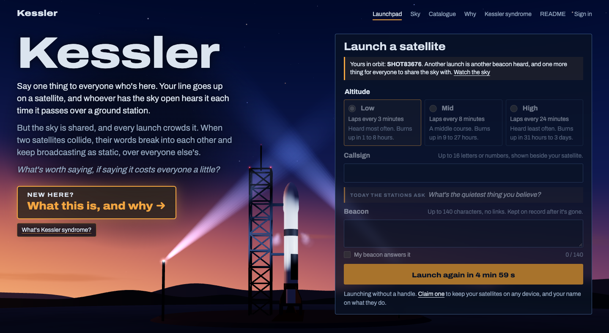
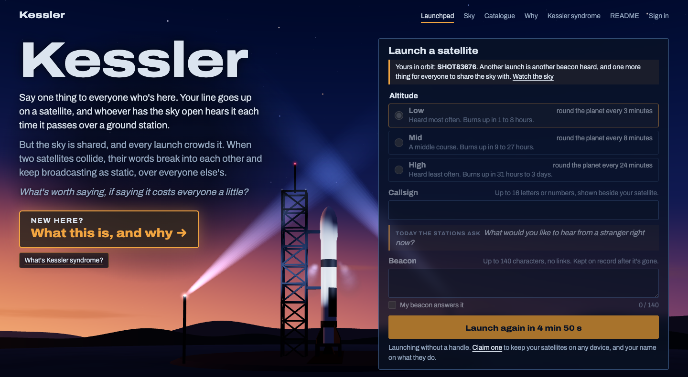

# Process overview

## What I built

Kessler is a shared sky anyone can launch into. Your satellite carries up to
140 characters, heard by whoever has the sky open as it passes one of three
ground stations. The design bets people will crowd the low band to be heard more, and crowding
causes collisions: both people's words break into static that takes airtime
from everyone. Nothing resets, and the record keeps who caused what. So: what's
worth saying, if saying it costs everyone a little?

## The stack

I built the app with Astro on the server, SQLite via Drizzle, and server-sent events (kept from crit 7), over SvelteKit or Phoenix LiveView and WebSockets: updates only flow server to client, so SSE was enough ([`183d624`](https://github.com/comp4020-agentic-coding-studio/comp4020-final-am167/commit/183d624), ADRs 0001, 0004). I compute satellite positions from the clock instead of running a simulation that ticks every second, because Fly stops an idle server and, on waking, it can replay exactly what it slept through ([`41f32ef`](https://github.com/comp4020-agentic-coding-studio/comp4020-final-am167/commit/41f32ef)). For visuals, I used Three.js and passed on the full 3D globe the agent suggested: I wanted a sky, not a diagram, and a globe would have meant rewriting the orbit logic ([`f8f7003`](https://github.com/comp4020-agentic-coding-studio/comp4020-final-am167/commit/f8f7003), ADR 0005).

## The workflow

`PLAN.md` holds discussions between me and the agent, what's agreed
and next, and each decision is an ADR, superseded rather than edited
([`183d624`](https://github.com/comp4020-agentic-coding-studio/comp4020-final-am167/commit/183d624)).
For each decision the agent laid out options without recommending one, and I
picked
([`9247b01`](https://github.com/comp4020-agentic-coding-studio/comp4020-final-am167/commit/9247b01)).

Before the deadline I ran a deep adversarial review:
reviewers, each blind to the others, attacked one part of the project each
against the spec, and verifiers tried to refute what they found. I triaged
its findings into fix or won't-fix; this is how I found the date-dependent tests and that CLAUDE.md had
no rules from the README
([`d63ea99`](https://github.com/comp4020-agentic-coding-studio/comp4020-final-am167/commit/d63ea99)).

## Corrections that became the harness

CLAUDE.md started from assignments 1 and 2
([`f9497fe`](https://github.com/comp4020-agentic-coding-studio/comp4020-final-am167/commit/f9497fe));
most rules since came from a correction I'd made more than once.

**The layout.** The launchpad and the sky must fit one desktop window, and
agents kept bringing scrolling back: each fix tuned the page to that day's
content, and the next feature undid it
([`69e92a0`](https://github.com/comp4020-agentic-coding-studio/comp4020-final-am167/commit/69e92a0), [`455789e`](https://github.com/comp4020-agentic-coding-studio/comp4020-final-am167/commit/455789e), [`67b29a9`](https://github.com/comp4020-agentic-coding-studio/comp4020-final-am167/commit/67b29a9)).
Repeating myself wasn't holding, so the rule became a check. I threw the
first attempt away: it hid parts at runtime until the page fit, and put a
Chrome test into `pnpm check` though CI has no Chrome
([PR #6](https://github.com/comp4020-agentic-coding-studio/comp4020-final-am167/pull/6)).
The rebuild
([PR #8](https://github.com/comp4020-agentic-coding-studio/comp4020-final-am167/pull/8))
is `pnpm test:layout`: Chrome at three desktop sizes, before and after a
launch, failing on any scroll or off-screen control, so hiding the overflow
can't pass. It failed 5 of 12 at first, and CLAUDE.md requires it
after any change to either page
([`8aa68f3`](https://github.com/comp4020-agentic-coding-studio/comp4020-final-am167/commit/8aa68f3)).
The first fix put the bands side by side
([`ade7d43`](https://github.com/comp4020-agentic-coding-studio/comp4020-final-am167/commit/ade7d43));
I thought it looked worse, so they went back to rows
([`59480dd`](https://github.com/comp4020-agentic-coding-studio/comp4020-final-am167/commit/59480dd)).
The test holds the constraint; whether it looks right is still my call.

**The suite aimed at the live sky.** Before final submission I had the agent
run the course's preflight skill, which runs `pnpm check`. The skill suggested the
deployed app's URL and the agent followed it, three times, instead of using a local build, and nothing in the harness warned that
the suite launches hundreds of test satellites into whatever it targets. The
live server stalled for twenty minutes, and the resulting debris cascade
caused every collision from then on. I had the agent trace every collision
back to a test launch and remove them, rather than restore a snapshot and lose
real launches. That lesson is now enforced: the spec rejects any
`fly.dev` address unless explicitly overridden, and CLAUDE.md explains why
([`21de098`](https://github.com/comp4020-agentic-coding-studio/comp4020-final-am167/commit/21de098)).

**Three failures I'd fixed one at a time** until each became a rule
([`c89bcbf`](https://github.com/comp4020-agentic-coding-studio/comp4020-final-am167/commit/c89bcbf)):

- *Tests that couldn't fail.* A review found tests passing with their feature
  broken
  ([`262e2b4`](https://github.com/comp4020-agentic-coding-studio/comp4020-final-am167/commit/262e2b4)),
  then the never-collide test passed with the rule reverted, because it
  compared against the constant
  ([`4e34a4a`](https://github.com/comp4020-agentic-coding-studio/comp4020-final-am167/commit/4e34a4a)).
  Now a rule's test must go red with the rule reverted.
- *Numbers that looked right.* Two reviews running, the agent's reasoned
  collision rates were wrong. Balance numbers now come from
  `scripts/balance/`, which runs the real server code over scratch databases
  ([`3469642`](https://github.com/comp4020-agentic-coding-studio/comp4020-final-am167/commit/3469642)).
- *Correct but unreadable.* The object card passed tests and review, but I
  couldn't follow it
  ([`d409ccf`](https://github.com/comp4020-agentic-coding-studio/comp4020-final-am167/commit/d409ccf)),
  as with assignment 2's home page. Reviewers now also read as a first-time
  visitor and flag any sentence that needs the project's context.

## Making the purpose clear

This was where I could direct the agent least: a test can say a page scrolls,
not whether the app means anything. In crit 8 the tutor pointed out I'd given
people a reason to be seen but nothing shared to lose
([`3de1cc6`](https://github.com/comp4020-agentic-coding-studio/comp4020-final-am167/commit/3de1cc6)),
and players said it felt like a Kessler syndrome visualiser. The agent's
diagnosis: the app said why the project existed, not why a visitor should
care. I accepted three of its proposed ADRs: beacons heard by people
([`e0db217`](https://github.com/comp4020-agentic-coding-studio/comp4020-final-am167/commit/e0db217)),
a wreck that broadcasts both people's words as static
([`fd0a0df`](https://github.com/comp4020-agentic-coding-studio/comp4020-final-am167/commit/fd0a0df)),
and a daily question from the stations
([`248469e`](https://github.com/comp4020-agentic-coding-studio/comp4020-final-am167/commit/248469e)).
I rejected reply launches and meaning-matched collisions, which would make
collisions a choice or a judgement.

A review found parts only for show: an "answering today's question" box
ticked by default linked strangers who never meant to answer, and fake
connections inflated "heard" counts. Both were fixed
([`1472389`](https://github.com/comp4020-agentic-coding-studio/comp4020-final-am167/commit/1472389),
[`262e2b4`](https://github.com/comp4020-agentic-coding-studio/comp4020-final-am167/commit/262e2b4)).
I refused its idea of staging collisions between two people's satellites,
which would mean the server destroying someone's on purpose
([`72a17dd`](https://github.com/comp4020-agentic-coding-studio/comp4020-final-am167/commit/72a17dd)).

A quiet sky was empty, so invented regulars and visitors now launch
like anyone
([`df4014c`](https://github.com/comp4020-agentic-coding-studio/comp4020-final-am167/commit/df4014c),
ADR 0021). That raises a question of honesty: the review found the Why page still
promised "real people's words", and a first deploy rewrote real people's
history. Both were fixed; the README says the sky is seeded
([`3469642`](https://github.com/comp4020-agentic-coding-studio/comp4020-final-am167/commit/3469642), re-landed in [`9096558`](https://github.com/comp4020-agentic-coding-studio/comp4020-final-am167/commit/9096558)).

## Balancing the staged collisions

Most satellites should burn up, but whoever marks it visits for ten minutes,
and an agent review in crit 9 showed they'd likely see no collision
([`44487ac`](https://github.com/comp4020-agentic-coding-studio/comp4020-final-am167/commit/44487ac)).
So when someone watches, the server sends two derelicts at each other
([`2dc518c`](https://github.com/comp4020-agentic-coding-studio/comp4020-final-am167/commit/2dc518c)).
Each fix after that overshot, tests green throughout:
nothing was broken, it just felt wrong.

| Round | Found | Changed |
| --- | --- | --- |
| My playing | Nothing burned up. Measured first: staged debris sat in the low band, only 3% burned up | Stage below the bands ([`a286df9`](https://github.com/comp4020-agentic-coding-studio/comp4020-final-am167/commit/a286df9)) |
| A context-free agent on a real server | The harm had moved to late in a satellite's life; ~20 collisions an hour ([PR #10](https://github.com/comp4020-agentic-coding-studio/comp4020-final-am167/pull/10)) | A staged wreck only falls, hitting nothing |
| Two Opus reviews | Natural collisions killed ~77%; staging every five minutes | Half of close pairs never collide; stage every 10–15 minutes ([`4e34a4a`](https://github.com/comp4020-agentic-coding-studio/comp4020-final-am167/commit/4e34a4a), ADR 0020) |

Now 57% of satellites in a quiet sky burn up, and 99.5% of newcomers see a
collision within ten minutes
([`d7b89f7`](https://github.com/comp4020-agentic-coding-studio/comp4020-final-am167/commit/d7b89f7)).
Runs gave the numbers; only playing told me whether it felt right.

## What good means here

Shirky's situated software lets the group do work the code doesn't, and
Ostrom found commons survive when users can see what each takes, so Kessler
does no moderation, only a record of what each launch cost. Kazemi's small
communities hold because their members are screened friends; Kessler's sky
is full of strangers, so the limits sit in the rules: a minute between
launches, 200 up at a time, nothing reset. Where I part from them is time:
their good is something a group reaches over months, and a visitor gives
Kessler ten minutes. Staging collisions bets that seeing the cost matters
more than a sky left alone. The agents did most of the building, but whether
it was good was my judgement.
